


 

  

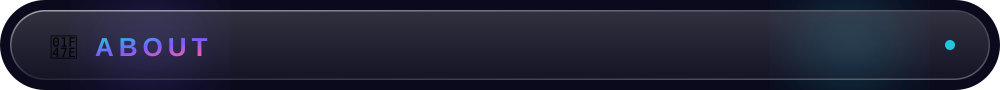

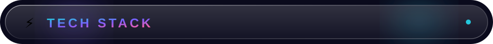
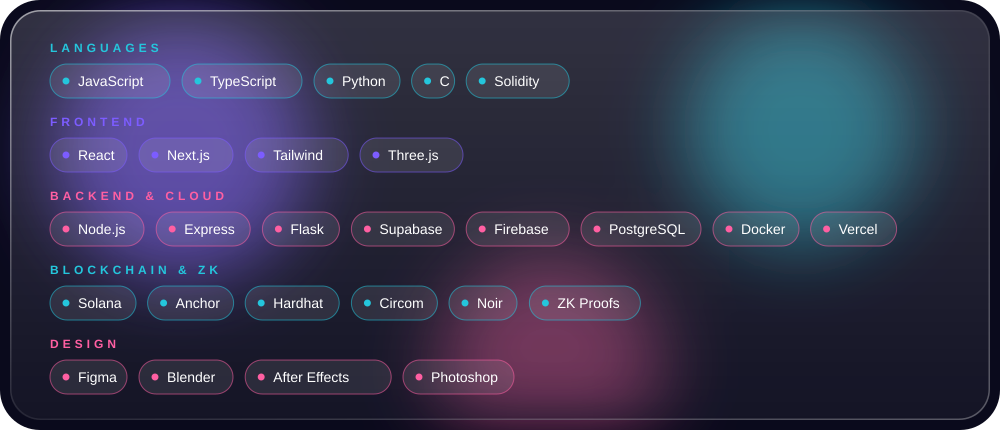

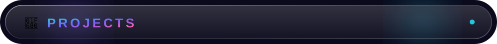

<!-- TODO: point each link at the real repo, e.g. https://github.com/Beastburner/ServiSync -->
<table>
  <tr>
    <td><a href="https://github.com/Beastburner?tab=repositories">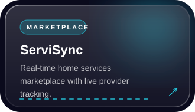</a></td>
    <td><a href="https://github.com/Beastburner?tab=repositories">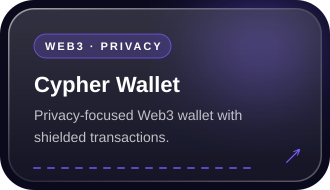</a></td>
    <td><a href="https://github.com/Beastburner?tab=repositories">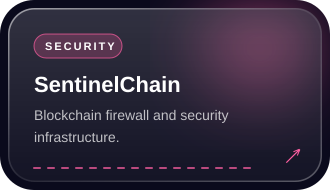</a></td>
  </tr>
  <tr>
    <td><a href="https://github.com/Beastburner?tab=repositories">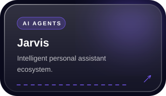</a></td>
    <td><a href="https://github.com/Beastburner?tab=repositories">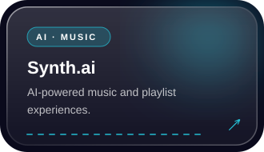</a></td>
    <td></td>
  </tr>
</table>

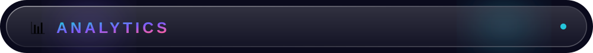

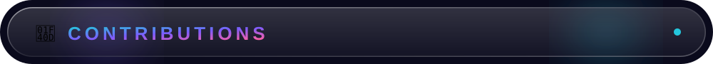

<picture>
  <source media="(prefers-color-scheme: dark)" srcset="https://raw.githubusercontent.com/Beastburner/Beastburner/output/github-snake-dark.svg" />
  <source media="(prefers-color-scheme: light)" srcset="https://raw.githubusercontent.com/Beastburner/Beastburner/output/github-snake.svg" />
  
</picture>

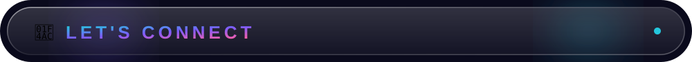

<!-- TODO: replace each YOUR_* with your real link -->
<a href="YOUR_PORTFOLIO_URL">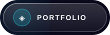</a>
<a href="YOUR_LINKEDIN_URL">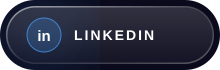</a>

<a href="mailto:YOUR_EMAIL">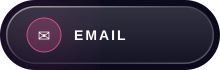</a>

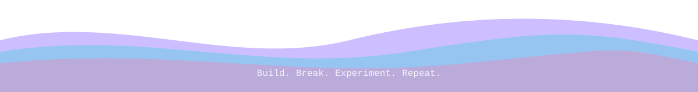

